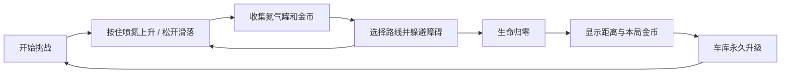

# Roadster：氮气飞驰 — 游戏设计与实现方案

版本：v0.1 · 2026-10-24 · 当前交付为设计方案，尚未实现游戏或执行运行测试。

## Primary goal / 核心目标

制作一款可以在电脑上独立运行的 2D 飞行避障小游戏：玩家驾驶红色 Tesla Roadster，在霓虹城市中通过喷氮控制高度，收集氮气罐和金币延长飞行，并用积累的金币永久升级车辆，再挑战更远距离。

完成标准：Windows 游戏包能独立启动，完整走通“开始飞行 → 收集与避障 → 结算 → 车库升级 → 再次挑战”，退出重开后保留金币、升级与最高纪录。

## 一、已确认的方向与默认设定

| 项目 | 设计决定 | 状态 |
| --- | --- | --- |
| 平台 | 电脑独立游戏，之后考虑手机版 | 用户已确认 |
| 操作 | 自动前进；按住喷氮上升，松开下落 | 用户已确认 |
| 成长 | 本局结束后在车库永久升级氮气耐用性和生命值 | 用户已确认 |
| 美术 | 霓虹科幻；红色 Roadster、蓝色氮气尾焰 | 用户已确认 |
| 首发系统 | Windows x64，横屏 | 根据当前工作环境默认；其他桌面系统另行导出验证 |
| 游戏模式 | 单人、离线、无尽生存，以飞行距离追纪录 | 本方案默认，可调整 |
| 金币作用 | 拾取时补少量氮气，同时积累为升级货币 | 依用户原始要求及问答设计 |
| 生命力含义 | 车辆可承受的碰撞次数 | 本方案解释 |

设计重心是“为了续航主动寻找补给，同时判断取金币是否值得冒险”。永久升级提高容错，核心挑战仍来自高度控制与路线选择。

## 二、一局怎么玩

### 核心循环



1. 车辆固定在画面左侧约 22% 的位置，场景与障碍向左移动，营造持续前进的感觉。
2. 按住空格或鼠标左键，尾部喷出蓝色氮气，车辆向上加速；松开后受重力下落。
3. 收集蓝白色高压氮气罐，明显恢复燃料；金币排成引导路线，同时提供少量补气和永久货币。
4. 在安全补给路线和高收益金币路线之间做选择，避开电网、建筑与无人机。
5. 碰撞或触地损失生命；生命归零结束。已收集的金币保留。
6. 在结算页重试，或进入车库购买升级；下一局从满氮气、满生命开始。

### 操作与边界

| 输入或情况 | 行为 |
| --- | --- |
| 按住空格 / 鼠标左键 | 有氮气时持续喷射、向上加速 |
| 松开 | 停止喷射、自然下落，保留少量基础消耗 |
| Esc | 暂停 / 恢复；退出游戏须经暂停菜单 |
| 窗口失去焦点 | 自动暂停；返回后由玩家主动恢复 |
| 氮气耗尽 | 无法喷射，但本局继续；滑落途中仍能拾取补给恢复控制 |
| 到达上边界 | 停止继续上升，不扣血；持续按住仍消耗氮气 |
| 触地 | 扣 1 格生命；若仍存活，短暂救援回安全高度，竖直速度清零，不补氮气 |

触地救援让生命升级对坠落也有帮助。每次触地都扣生命，普通碰撞后的保护时间不抵消触地扣血，避免依靠贴地连续存活。菜单与结算状态不接收飞行输入。

### 碰撞反馈

- 每次有效障碍碰撞扣 1 格生命；随后有 1.2 秒障碍伤害保护，车体闪烁。
- 保护结束时，只有已经离开再接触的障碍才能再次造成伤害；持续重叠按同一次接触处理。
- 障碍是伤害触发区，不把车卡在障碍上；背景装饰不参与伤害判定。
- 车辆碰撞框略小于可见车体，尾焰不参与判定。
- 生命归零只触发一次结算，停掉生成、计分和拾取。

## 三、氮气与金币的初始数值

以下都是首轮试玩的调参起点，不是已验证的平衡结果。统一放在配置资源中，避免散落在代码里。

| 项目 | 初始值 | 设计用途 |
| --- | --- | --- |
| 氮气上限 / 开局氮气 | 100 / 100 | 给新手学习操作的缓冲 |
| 喷射总消耗 | 10 单位/秒 | 包含基础消耗，不能再额外叠加基础消耗 |
| 松开时基础消耗 | 1 单位/秒 | 维持主动寻找补给的动力 |
| 氮气罐恢复 | +35，封顶 100 | 主要续航来源 |
| 每枚金币 | +1 氮气、+1 金币 | 同时产生短期和长期收益；满氮气仍能得金币 |
| 初始生命 | 3 格 | 三次有效伤害后结束 |
| 障碍伤害保护 | 1.2 秒 | 防止同一瞬间连扣生命 |
| 低氮气提醒 | 低于 20% | 仪表变色并给短促提示音，限制重复提示 |

补给节奏起点：标准可行路线每 6—9 秒出现一个氮气罐；每 6—8 秒安排一组约 6 枚金币。支路金币属于额外奖励，不计入必需补给。

例如，假设玩家一半时间喷射，平均消耗约为 `(10 + 1) / 2 = 5.5` 单位/秒；每 7.5 秒取得一罐、每 7 秒取得 6 枚金币，理论补给约为 `35 / 7.5 + 6 / 7 ≈ 5.52` 单位/秒。这个演算仅说明起点接近收支平衡；实际会漏捡、溢出、改变喷射比例，必须通过试玩调整。

调参目标：新玩家首几局有机会坚持 45—90 秒，熟练玩家依靠补给持续飞行；第一项升级通常在约 1—3 局后买得起。以真实试玩结果决定是否达标。

### 飞行手感起点

- 逻辑画面 1280 × 720，重力 1000 像素/秒²，喷射向上加速度 1800 像素/秒²。
- 竖直速度上限暂设为上升 430、下落 430 像素/秒；按住时净加速度向上，松开时向下。
- 视觉车体约 112 × 46 像素，初始碰撞框约 92 × 34；形状随最终素材调整。
- 车头随竖直速度小幅俯仰，旋转仅影响视觉，首版碰撞框保持稳定。
- 高度控制、燃料消耗、世界移动和距离累计全部按物理时间推进。

## 四、车库与永久升级

### 氮气耐用性

将“罐更耐用”实现为降低氮气消耗。每级降低基础消耗的 8%，最高 5 级，共降低 40%；不增加油箱容量，也不改变罐的恢复量，效果更容易理解和调平衡。

| 升到等级 | 本次花费 | 相对基础消耗 | 持续喷射时，35 单位氮气约能用 |
| --- | --- | --- | --- |
| 0，初始 | — | 100% | 3.50 秒 |
| 1 | 50 | 92% | 3.80 秒 |
| 2 | 100 | 84% | 4.17 秒 |
| 3 | 180 | 76% | 4.61 秒 |
| 4 | 280 | 68% | 5.15 秒 |
| 5 | 420 | 60% | 5.83 秒 |

公式：`实际消耗 = 对应状态的基础消耗 × (1 - 0.08 × 耐用等级)`。同样作用于松开时的基础消耗；不会叠乘到负值。

### 车辆生命

| 升到等级 | 本次花费 | 每局最大生命 |
| --- | --- | --- |
| 0，初始 | — | 3 格 |
| 1 | 80 | 4 格 |
| 2 | 180 | 5 格 |
| 3 | 360 | 6 格 |

车库展示当前效果、下一级效果、价格和余额；余额不足与满级状态清晰可见。每次购买同时更新余额与等级，保存成功后确认购买。存档失败则撤回该次购买并提示。

两条升级线全部升满共需 1650 金币。首版不加入金币收益倍率，以免升级同时放大收入，导致后续价格很快失效。

## 五、场景、障碍与难度

### 第一版场景

一个霓虹城市主题，利用远景天际线、中景高架与近景灯带的不同滚动速度表现空间感。车辆、补给与危险保持清晰轮廓；发光效果不能遮住可通行区域。

| 类型 | 玩家应对方式 | 初版安排 |
| --- | --- | --- |
| 建筑与立柱 | 提前升高或下降，绕过固定障碍 | 最先引入 |
| 上下电网门 | 控制高度，通过预留间隙 | 中期引入 |
| 巡航无人机 | 观察上下运动节奏，选择通过时机 | 基础玩法稳定后引入 |

无人机在玩家看到它时就显示运动规律；不在贴近车辆时突然启动。装饰灯带和危险电网在颜色、形状与动画上区分。

### 障碍生成方式

首版制作 12 个可复用路线片段：6 个简单、4 个中等、2 个困难。每段包含障碍、补给、入口高度范围、出口高度范围与可衔接片段列表。

生成器按难度抽取符合衔接条件的片段，在屏幕右侧提前生成；超出左侧视野的内容及时释放。先证明片段和衔接可玩，再增加随机变化。

公平性约束：

1. 以未升级车辆作为可通过性的基准，永久升级不成为通关门槛。
2. 每个片段及允许的前后衔接，至少有一条符合实际加速度与速度上限的安全路线；只检查几何上有缝隙不够。
3. 一条连续安全路线同时包含必要补给，不能要求玩家在两个无法兼顾的高度取罐。
4. 从危险清晰出现到车头到达其位置，至少保留约 1.5 秒；最高速度下重新核算。
5. 简单路线的垂直通道起点不小于约 160 像素，最终值由车体和试玩结果决定。
6. 新手开局前 10 秒无伤害障碍，先用金币弧线和氮气罐教授操作。
7. 难度过渡留出缓冲，不连续拼接两个要求极端反向操作的片段。

可通过性指玩家遵循已提供的路线、收集必要补给时存在解；不保证错过补给或错误操作后仍能无损挽回。

### 难度曲线

- 前 10 秒学习，10—30 秒只出现简单静态障碍。
- 30—90 秒逐步加入电网与高度变化，90 秒后开放全部片段。
- 世界滚动速度起点 340 像素/秒，按游玩时间逐步升至约 520 的上限。
- 长局主要靠片段组合和取舍维持挑战；速度和通道宽度都有下限或上限，避免无限提速变成必败。
- 暂停、菜单和倒计时均不推进难度时间。

## 六、界面、美术与声音

### 游戏画面布局

```text
┌──────────────────────────────────────────────────────────┐
│ 氮气 ▰▰▰▰▰▱▱  生命 ♥♥♥          金币 038   距离 620m   │
│                                                          │
│                  ○ ○ ○              ┃电网┃               │
│       红色车  >>>         [N₂]        ┃    ┃               │
│                          ○ ○ ○                           │
│     远景城市 / 高架桥 / 霓虹灯带                         │
│────────────────────地面警戒带────────────────────────────│
│ 首局提示：按住空格上升，松开下落              Esc 暂停    │
└──────────────────────────────────────────────────────────┘
```

- 主菜单：开始挑战、车库、设置、退出；显示最高距离。
- HUD：氮气条、生命格、本局金币、距离；危险出现时不遮挡通道。
- 结算：本局距离、新纪录提示、本局金币、总余额、重试和车库入口。
- 车库：红色车辆展示与两张升级卡，购买后立刻看到属性变化。
- 设置：音乐、音效、窗口/全屏，以及屏幕震动开关。

### 资源需求

- 红色 Roadster 侧面车体 1 套；蓝色尾焰至少含停止、短喷与长喷状态。
- 蓝白色高压氮气罐、金色硬币及各自拾取反馈。
- 城市远中近三层背景；3 类障碍及其清晰危险标识。
- 喷氮循环音、金币音、补气音、撞击音、低气量提醒、升级音，以及一首循环背景音乐。
- 一套能完整显示中文的字体；常用按钮、属性图标与界面面板。

霓虹效果优先采用带柔光边缘的贴图和叠加，控制粒子数量；不把视觉效果绑定到高成本全屏后期处理。金币用圆形轮廓、氮气罐用圆柱轮廓，降低仅靠颜色区分的负担。

## 七、技术架构

### 技术选择

采用 **Godot 4.7.2 标准版 + GDScript**，初版使用 Compatibility 渲染器，导出 Windows x64。

截至本方案日期，官方 Windows 下载页列出的稳定版为 4.7.2；将编辑器、导出模板与文档锁定在同一版本线。[官方 Windows 下载页](https://godotengine.org/download/windows/)

Compatibility 是官方列出的 2D 与广泛硬件兼容场景的选择之一。本项目据此优先采用它，再以实际场景性能验收。[渲染器选择文档](https://docs.godotengine.org/en/4.7/tutorials/rendering/renderers.html#choosing-a-renderer)

基准分辨率为 1280 × 720，使用 `canvas_items` 和 `keep` 保持 16:9；1280 × 720 与 1920 × 1080 下可见世界范围保持一致。其他比例先用留边处理，避免宽屏玩家得到额外预判距离。[多分辨率文档](https://docs.godotengine.org/en/4.7/tutorials/rendering/multiple_resolutions.html)

### 场景与模块职责

下列名称是本项目拟建模块，不是引擎内置 API。

| 模块 | 职责 | 不承担的职责 |
| --- | --- | --- |
| `App` / 界面路由 | 切换主菜单、车库、游戏与设置 | 不计算飞行物理 |
| `RunController` | 本局状态、距离、失败、结算协调 | 不自行增加金币或重复执行拾取 |
| `FlightController` | 竖直运动、氮气、生命、伤害保护与触地救援 | 不写存档 |
| `SpawnDirector` | 路线片段、种子、难度与实体清理 | 不决定升级价格 |
| `Pickup` / `Hazard` | 接触检测与一次性拾取/伤害事件 | 不直接控制 HUD |
| `SaveService` | 金币余额、永久等级、设置、纪录、保存与恢复 | 不推进本局物理 |
| `UpgradeCatalog` / `GameBalance` | 升级效果、价格、数值及片段配置 | 不保存当前氮气等本局状态 |
| UI 场景 | 显示状态与提交按钮意图 | 不复制一份经济或物理公式 |

车辆使用 `CharacterBody2D`；补给和危险触发区使用 `Area2D`。车辆仅与固定世界边界发生实体碰撞，与危险接触时受伤而不被阻挡。车体固定水平位置，世界元素按统一速度向左滚动。

配置采用自定义 `Resource` / `.tres`；它是数据源，运行时生命和氮气存放在本局实例中，避免修改共享资源导致新一局继承残值。[官方资源与场景实例化示例](https://docs.godotengine.org/en/4.7/tutorials/scripting/resources.html)

### 状态与暂停

状态集合：`MENU`、`GARAGE`、`COUNTDOWN`、`PLAYING`、`PAUSED`、`RESULT`。只有 `PLAYING` 接受飞行输入并推进世界。

暂停采用 `SceneTree.paused`，游戏世界使用可暂停模式，暂停菜单使用暂停时可处理的模式。恢复按钮、音量设置和退出按钮仍可操作；所有拾取和伤害回调同时检查本局状态。[官方暂停示例](https://docs.godotengine.org/en/4.7/tutorials/scripting/pausing_games.html#pause-menu-example)

### 金币与存档

- 金币拾取仅处理一次：立即更新内存余额与本局计数；结算只展示，不再加一次金币。
- 采用约 2 秒合并自动保存；暂停、结算、购买和正常退出时立即保存。突然断电或进程崩溃时，可能丢失最近一个保存间隔的拾取进度。
- 使用 `ConfigFile` 写入 `user://progress.cfg`；维护上一份有效备份，检查保存返回值，不把 ConfigFile 的普通保存误认为原子事务。
- 主档损坏时加载有效备份；两份均无效时保留原文件并提示，使用临时默认进度，不静默覆盖坏档。
- 存档含 `schema_version`、`wallet`、`durability_level`、`health_level`、`best_distance`、音量与显示设置；读取时检查类型和上下界。
- 购买把新余额和新等级作为同一份快照保存，成功后才确认；避免扣钱成功而等级没有更新。

`user://` 用于持久数据；导出后不能假定 `res://` 可写。ConfigFile 改值后需要显式保存，并检查错误。[ConfigFile 存取示例](https://docs.godotengine.org/en/4.7/classes/class_configfile.html#description)、[数据路径说明](https://docs.godotengine.org/en/4.7/tutorials/io/data_paths.html#accessing-persistent-user-data-user)

### 拟建目录

```text
project.godot
scenes/
  app.tscn
  run.tscn
  player/roadster.tscn
  pickups/coin.tscn, nitro_tank.tscn
  hazards/pillar.tscn, electric_gate.tscn, drone.tscn
  chunks/
  ui/main_menu.tscn, hud.tscn, garage.tscn, pause.tscn, result.tscn
scripts/
  run_controller.gd
  flight_controller.gd
  spawn_director.gd
  save_service.gd
data/
  game_balance.tres
  upgrades.tres
assets/
  sprites/, backgrounds/, audio/, fonts/
tests/
docs/
builds/windows/
```

## 八、分阶段实施计划

### Phase 0：文档核实与项目准备

**How this serves the primary goal / 如何服务核心目标：** 确定能交付电脑独立游戏的真实工具、接口和导出方式，避免用浏览器方案替代用户选择的平台。

**实施内容：** 本轮已查阅下表官方文档并核实技术路线。进入开发时准备 Godot 4.7.2 标准版、匹配的导出模板、中文字体、输入映射及最小空项目；当前工作区为空，尚未检测到命令行可用的 Godot，不代表已检查所有安装位置。

**允许使用的已核实接口：**

| 功能 | 已核实接口 / 配置 | 官方参考及可复制位置 |
| --- | --- | --- |
| 固定物理更新 | `_physics_process(delta: float)` | [Node 方法](https://docs.godotengine.org/en/4.7/classes/class_node.html#class-node-private-method-physics-process) |
| 车辆运动 | `CharacterBody2D.velocity`，`move_and_slide()` | [velocity 与运动方法](https://docs.godotengine.org/en/4.7/classes/class_characterbody2d.html#class-characterbody2d-property-velocity)、[Platformer movement 示例](https://docs.godotengine.org/en/4.7/tutorials/physics/using_character_body_2d.html) |
| 持续按住 | `Input.is_action_pressed(action, exact_match = false)` | [Input 方法](https://docs.godotengine.org/en/4.7/classes/class_input.html#class-input-method-is-action-pressed)、[Events versus polling](https://docs.godotengine.org/en/4.7/tutorials/inputs/input_examples.html#events-versus-polling) |
| 拾取 / 伤害区 | `Area2D.body_entered(body)`，`monitoring`，碰撞层与掩码 | [Area2D Signals](https://docs.godotengine.org/en/4.7/classes/class_area2d.html#signals) |
| 实例化与配置 | `PackedScene.instantiate()`、自定义 `Resource` | [Loading scenes / Creating your own resources](https://docs.godotengine.org/en/4.7/tutorials/scripting/resources.html) |
| 持久化 | `ConfigFile.set_value()`、`get_value()`、`load()`、`save()` | [ConfigFile Description 的完整 GDScript 示例](https://docs.godotengine.org/en/4.7/classes/class_configfile.html#description) |
| 暂停 | `SceneTree.paused`、`Node.process_mode` | [Pause menu example](https://docs.godotengine.org/en/4.7/tutorials/scripting/pausing_games.html#pause-menu-example) |
| 画面适配 | `display/window/size/viewport_width`、`viewport_height`；`display/window/stretch/mode`、`aspect` | [Multiple resolutions](https://docs.godotengine.org/en/4.7/tutorials/rendering/multiple_resolutions.html) |
| 桌面交付 | Windows 导出与匹配模板，目标 x86_64 | [Windows export](https://docs.godotengine.org/en/4.7/tutorials/export/exporting_for_windows.html)、[Export templates](https://docs.godotengine.org/en/4.7/tutorials/export/exporting_projects.html#export-templates) |

**验收：** 空场景能从编辑器运行，也能导出为 Windows 程序独立启动；记录工具版本和实际测试设备。

**防错：** 不混用 Godot 3 与 4 的运动写法；不使用未核实的插件；加速度积分乘 delta，velocity 不额外乘 delta，`move_and_slide()` 不传 delta；新增引擎接口先核实相应版本文档。

### Phase 1：验证飞行手感

**How this serves the primary goal / 如何服务核心目标：** 先让“按住上升、松开下落”足够好玩，确保游戏最核心的操作成立。

**实施内容：** 从官方 CharacterBody2D 移动示例复制物理更新结构，加入喷氮加速度、速度上限、氮气消耗、上下边界与简易数值面板；素材先用轮廓占位，保留车体尺寸。

**文档参考：** Phase 0 的 CharacterBody2D、Node、Input；持续按住采用官方轮询示例，飞行动作只在 `PLAYING` 状态生效。

**验收：** 空格与鼠标都能控制；按住消耗 10/秒、松开消耗 1/秒；氮气不为负；耗尽后失去推力，补气后恢复；不同显示帧率下相同物理输入的运动与消耗基本一致；调整到能稳定穿过练习通道。

**防错：** 不靠每帧固定减值计燃料；不把下落直接改成匀速；连续运动不直接改 position 代替物理移动，救援等离散重置另行处理。

### Phase 2：打通一局

**How this serves the primary goal / 如何服务核心目标：** 让玩家真正经历收集、避障、生命耗尽与重试，验证玩法循环。

**实施内容：** 从 Area2D 检测模式建立金币、氮气罐和静态障碍；加入生命、伤害保护、触地救援、距离、HUD、倒计时、暂停与结算。先使用少量固定练习片段。

**文档参考：** Phase 0 的 Area2D Signals、Resources → Loading scenes、Pausing → Pause menu example。

**验收：** 两种拾取各自只生效一次；满氮气拾取金币仍增加余额；同次障碍接触不连扣；生命归零只结算一次；暂停 30 秒后燃料、位置、距离、生成时间均不变化；结算不重复入账；重试正确重置本局状态。

**防错：** 不同时在触发区与玩家两处处理同一拾取；不把尾焰设成受伤框；不把暂停菜单一起暂停；信号回调不能绕过游戏状态检查。

### Phase 3：加入永久成长

**How this serves the primary goal / 如何服务核心目标：** 让每次收集的金币在下一局体现为更长续航和更高容错，形成重复游玩的动力。

**实施内容：** 根据 ConfigFile 官方示例建立存档服务、有效备份、车库和两条升级线；数值采用自定义 Resource，购买按表格公式计算，UI 展示实际结果。

**文档参考：** Phase 0 的 ConfigFile Description、user:// 数据路径、Resources → Creating your own resources。

**验收：** 逐级核对价格与消耗倍率；余额不足和满级不能购买；快速重复点击不会多扣钱；购买后重启保留余额和等级；保存失败撤回购买；缺少字段有默认值；坏档能回退；新局按永久等级恢复满生命和满氮气。

**防错：** 不把永久等级直接复制成当前生命；不在结算时再次加金币；不把存档写入 res://；不将共享 Resource 当作本局可变状态。

### Phase 4：形成完整的无尽挑战与霓虹表现

**How this serves the primary goal / 如何服务核心目标：** 提供有变化、可判断、可持续挑战的飞行路线，并实现用户选定的视觉风格。

**实施内容：** 建立 12 个路线片段及允许衔接，加入难度曲线和无人机；替换红车、蓝焰、背景、补给与障碍素材；完成拾取、受伤、低气量和升级的视听反馈。实体移出视野及时释放，性能不足时再针对瓶颈引入复用。

**文档参考：** Resources 的场景实例化与共享资源说明；Multiple resolutions 的 canvas_items / keep；Renderers 的 Compatibility 适用范围。动态实体延用前述物理与碰撞接口。

**验收：** 每个片段和每条允许衔接均有基础车辆可执行的线路；用固定输入回放与种子辅助复现；抽检至少 1000 组片段序列并人工试玩关键转场；最高速度仍保留预判时间；特效不遮挡危险；连续运行实体数量和内存不持续增长。

**防错：** 不以纯随机坐标生成障碍；不把几何间隙当成物理可达的证明；不为增长难度无限提高速度；不因更宽窗口扩大可见游戏区域。

### Phase 5：验收与 Windows 交付

**How this serves the primary goal / 如何服务核心目标：** 将编辑器中的项目变成玩家拿到就能运行、退出后还能保留进度的游戏。

**实施内容：** 按官方导出文档输出 Windows x64 发布包，检查字体与所需语言数据；整理源码、操作说明、素材清单和版本记录，完成真实设备试玩与必要问题修复。

**文档参考：** Windows export、Export templates、Data paths、Pausing；检查实现与 Phase 0 锁定的接口和版本一致。

**验收：**

- 没有安装 Godot 的 Windows 测试环境能解压运行；运行不依赖开发机绝对路径。
- 完整体验“飞行 → 拾取 → 受伤 → 结算 → 购买 → 退出 → 重开”，进度与显示一致。
- 覆盖零氮气、零生命、满氮气、满级、余额不足、存档损坏、存档写入失败、暂停中退出、失去焦点、快速重试与金币重复触发。
- 以输入回放比较不同显示帧率下的燃料和轨迹；公式检查覆盖两条升级线的每一级。
- 在记录了硬件和分辨率的参考电脑上，以 1080p、目标 60 FPS 连续试玩 30 分钟，检查明显卡顿、错误日志和资源泄漏；未测前不宣称最低硬件要求。
- 核对中文字体、音量设置、窗口切换、界面点击区域和导出资源完整性；静态搜索排查旧版本运动写法、res:// 存档及散落的经济常量。

**防错：** 不以编辑器能运行代替发布包验证；不把方案里的目标当成已通过测试；只对数值、存档、碰撞、状态与生成等有行为风险的逻辑做必要自动检查，视觉与手感结合人工试玩验收。

## 九、首版范围与后续

首版交付：一个霓虹城市主题、一辆红色 Roadster、单人无尽模式、两种拾取物、三类障碍、两条永久升级线、完整菜单与车库、离线存档、Windows x64 游戏包及源码。

后续候选：新场景、外观、任务、成就、更多车辆与手机横屏版。首版暂不包含联网排行、账户系统、付费系统、多人对战或微信小游戏。

移动版可沿用飞行动作和数据模块，使用触屏按钮映射同一个动作；仍需重新验证屏幕安全区域、触控手感、字体、性能和各平台导出环境。[TouchScreenButton.action](https://docs.godotengine.org/en/4.7/classes/class_touchscreenbutton.html#class-touchscreenbutton-property-action)

## 十、当前结论

用户已确认的关键选择足以开始第一阶段开发，无需追加前置问答。本轮完成了设计与文档核实，并未安装引擎、生成正式美术或实现游戏。建议下一个开发交付物是 Phase 1 的可运行飞行原型，以实际操作验证推进、下落和氮气消耗手感，再按后续阶段完成整局与成长系统。
